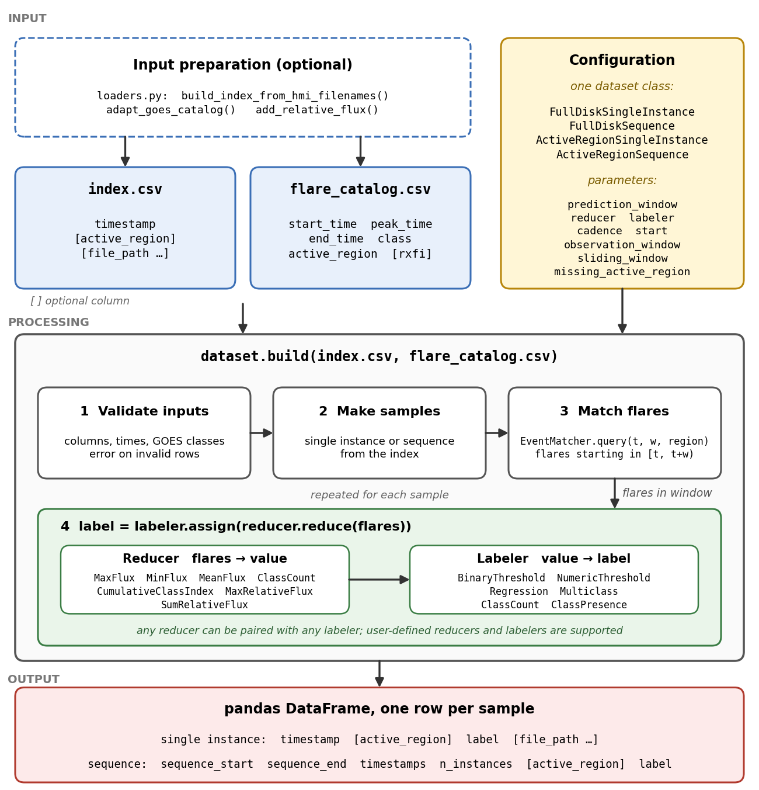

# SOLIX

SOLIX (Solar Observation Labeling and IndeXing) builds labeled datasets
for solar flare prediction.

You give it two tables: an index of your observations and a GOES flare
catalog. Each row of the index is one **instance**: a point in time and
whatever file belongs to it (an image, a `.npy` array, anything). The
package never opens the files, so any file type works. For each instance,
or each sequence of instances, it finds the flares that start in a
prediction window after it and turns them into a label. The result is one
pandas DataFrame, one row per instance or sequence, ready for a
machine-learning data loader.

- Full-disk and active-region instances.
- Single instances and sequences of instances.
- Binary, flux, class, count, cumulative-index and relative-X-ray-flux
  labels, or your own.
- Every choice is a named parameter, so a dataset can be rebuilt exactly.
- Pure Python. Only pandas and NumPy.

**Contents**

1. [How it works](#how-it-works)
2. [Installation](#installation)
3. [Quick start](#quick-start)
4. [Inputs](#inputs)
5. [The four dataset classes](#the-four-dataset-classes)
6. [Parameters](#parameters)
7. [The prediction window](#the-prediction-window)
8. [Labels: reducers and labelers](#labels-reducers-and-labelers)
9. [Output](#output)
10. [Preparing real data](#preparing-real-data)
11. [Errors and warnings](#errors-and-warnings)
12. [Examples](#examples)
13. [Repository structure](#repository-structure)
14. [Tests](#tests)
15. [License](#license)

---

## How it works



1. **Input.** Two CSV files: an index and a flare catalog. Optional
   helpers in `loaders.py` make them from raw data. The configuration is a
   dataset class and its parameters.
2. **Processing.** `dataset.build(index, flare_catalog)`:
   1. validates both files;
   2. makes the samples, single instances or sequences;
   3. for each sample, `EventMatcher` finds the flares that start in the
      window `[t, t + w)`;
   4. a **reducer** makes one value from those flares, and a
      **labeler** makes the label from the value.
3. **Output.** A pandas DataFrame with one row per sample.

---

## Installation

Python 3.10 or newer. Dependencies: pandas (2.0 or newer) and NumPy.

```bash
git clone https://github.com/assemkdv/solix.git
cd solix
pip install .
```

Optional extras:

| Command | Installs |
|---|---|
| `pip install -e ".[dev]"` | pytest, to run the tests |
| `pip install ".[pytorch-examples]"` | torch, pillow, astropy, for examples 06, 07, 10, 12 (12 needs only torch) |
| `pip install ".[tensorflow-examples]"` | tensorflow, pillow, astropy, for examples 08, 09, 11 |

The package is not on PyPI yet.

---

## Quick start

```python
import solix

dataset = solix.FullDiskSingleInstance(
    prediction_window="24h",                     # flares that start in [t, t + 24h)
    reducer=solix.MaxFluxReducer(),              # the strongest of them
    labeler=solix.BinaryThresholdLabeler("M"),   # 1 if it is M1.0 or stronger, else 0
)
labels = dataset.build("examples/data/full_disk_index.csv",
                       "examples/data/flare_catalog.csv")
print(labels.head(3))
```

```text
            timestamp  label
0 2024-03-01 00:00:00      1
1 2024-03-01 01:00:00      1
2 2024-03-01 02:00:00      1
```

Two steps, always the same: **create** a dataset object with a class and
its parameters, then **build** it from the two files.

---

## Inputs

### Index

One row per instance: a full-disk observation, or one active region at
one time.

| Column | Required | Meaning |
|---|---|---|
| `timestamp` | always | observation time of the instance |
| `active_region` | active-region classes | NOAA region number of the instance |
| any other, e.g. `image_path` | no | kept in the output on request |

```text
timestamp,active_region,image_path
2024-03-01 00:00:00,13600,patches/13600/patch_13600_20240301_0000.jpg
2024-03-01 00:00:00,13601,patches/13601/patch_13601_20240301_0000.jpg
```

A row can describe any observation with a time: an image, a `.npy`
array, a row of numbers. The other columns, such as a file path, are
passed through untouched.

### Flare catalog

One row per flare.

| Column | Required | Meaning |
|---|---|---|
| `start_time`, `peak_time`, `end_time` | yes | full date and time of the flare |
| `class` | yes | GOES class, e.g. `M1.4` |
| `active_region` | yes (cells may be blank) | NOAA region number |
| `rxfi` | only for the relative-flux reducers | relative X-ray flux increase, from `add_relative_flux` |
| `fl_lon`, `fl_lat` | no | flare location, kept if present |

```text
start_time,peak_time,end_time,class,active_region
2024-03-01 04:00:00,2024-03-01 04:12:00,2024-03-01 04:30:00,C3.2,13600
2024-03-01 13:20:00,2024-03-01 13:35:00,2024-03-01 13:50:00,M1.4,13600
```

Only `start_time` decides whether a flare is in a window. The three times
are checked for order: `start_time ≤ peak_time ≤ end_time`.

### Your own column names

If your files use other names, map them in `build()`:

```python
labels = dataset.build(
    "my_index.csv", "my_flares.csv",
    index_columns={"obs_time": "timestamp"},
    catalog_columns={"goes_class": "class"},
)
```

The output always uses the package's names.

### Times

Times with a UTC offset are converted to UTC. Times without one are used
as they are, so the index and the catalog must use the same time
scale (UTC for GOES). There is no TAI-to-UTC correction.

---

## The four dataset classes

| Class | One row per | Flares that count |
|---|---|---|
| `FullDiskSingleInstance` | full-disk instance | all flares |
| `FullDiskSequence` | sequence of full-disk instances | all flares |
| `ActiveRegionSingleInstance` | active-region instance | flares of its own region |
| `ActiveRegionSequence` | sequence of instances of one region | flares of that region |

All four share one engine (`DatasetBuilder`), so a parameter means the
same thing in every class.

**Sequences.** A sequence is a run of instances at a fixed time step. It
is labeled from the window after its **last** instance. Sequences are
built on an exact time grid: if any instance of the grid is missing, the
sequence is skipped, not filled with a nearby instance. Active-region sequences are built
separately for each region.

---

## Parameters

| Parameter | Single instances | Sequences | Default | Meaning |
|---|---|---|---|---|
| `prediction_window` | required | required | | length of the window, e.g. `"24h"`, `"12h"`, or a number of hours |
| `reducer`, `labeler` | required | required | | how flares become a label (see below) |
| `cadence` | optional | required | `None` | time between instances; for single instances, keeps one instance per cadence |
| `start` | optional | optional | earliest instance | first point of the cadence grid; must be an instance time |
| `observation_window` | | required | | time one sequence covers; a multiple of `cadence` |
| `sliding_window` | | required | | time between the starts of two sequences |
| `missing_active_region` | active region only | active region only | `"negative"` | instances without a region: `"negative"` (labeled as no flare, with a warning), `"drop"`, or `"error"` |
| `include_metadata` | optional | | `False` | keep the other index columns, e.g. `image_path` |
| `include_flares` | optional | optional | `False` | add a `flares` column listing the flares of each window |
| `verbose` | optional | optional | `False` | print a short summary of the build |

`cadence` and `sliding_window` must be multiples of the index's own time
step. A sequence has `observation_window / cadence` instances.

`build()` takes:

| Argument | Meaning |
|---|---|
| `index_path` | path to the index CSV |
| `event_catalog_path` | path to the flare catalog CSV |
| `return_report=False` | sequences only: also return a `SequenceBuildReport` |
| `index_columns`, `catalog_columns` | `{your column name: package column name}` |

---

## The prediction window

For a sample with reference time `t` and a prediction window `w`, a flare
counts if it **starts** in

```text
[t, t + w)        from t, up to but not including t + w
```

- `t` is the instance time, or the time of the **last** instance of a
  sequence.
- For active-region classes, only flares with the same `active_region`
  count.
- A flare that started before `t` does not count, even if it is still in
  progress.

---

## Labels: reducers and labelers

The `reducer` and `labeler` parameters decide how the flares of a window
become a label. A label is made in two steps:

```text
flares in the window  ──reducer──>  one value  ──labeler──>  label
```

### The two most common labels

| Reducer | Labeler | Label |
|---|---|---|
| `MaxFluxReducer()` | `BinaryThresholdLabeler("M")` | 1 if the strongest flare is ≥ M1.0, else 0 |
| `MaxFluxReducer()` | `RegressionLabeler()` | peak flux of the strongest flare (W/m²), 0.0 if none |

The threshold can be a letter (`"C"`, `"M"`, `"X"`) or a full class
(`"M5.0"`).

### Any reducer with any labeler

```python
dataset = solix.FullDiskSingleInstance(
    "24h",
    reducer=solix.CumulativeClassIndexReducer(),
    labeler=solix.NumericThresholdLabeler(10),
)
```

**Reducers** (flares → one value):

| Reducer | Value | Empty window |
|---|---|---|
| `MaxFluxReducer` | peak flux of the strongest flare (W/m²) | 0.0 |
| `MinFluxReducer` | peak flux of the weakest flare | 0.0 |
| `MeanFluxReducer` | mean peak flux of all flares | 0.0 |
| `ClassCountReducer` | number of flares per class, `{A, B, C, M, X}` | all zeros |
| `CumulativeClassIndexReducer` | ΣC + 10·ΣM + 100·ΣX of the class numbers (C2.6 → 2.6, M1.5 → 15) | 0.0 |
| `MaxRelativeFluxReducer` | largest `rxfi` | 0.0 |
| `SumRelativeFluxReducer` | sum of `rxfi` | 0.0 |

The two relative-flux reducers need the `rxfi` column and work for single
instances only.

**Labelers** (value → label):

| Labeler | Label | Use with |
|---|---|---|
| `BinaryThresholdLabeler("M")` | 1 if value ≥ the class flux, else 0 | flux reducers |
| `NumericThresholdLabeler(10)` | 1 if value ≥ the number, else 0 | cumulative index, rxfi |
| `RegressionLabeler()` | the value itself | any number |
| `MulticlassLabeler()` | `"NF"`, `"A"`, `"B"`, `"C"`, `"M"` or `"X"` | `MaxFluxReducer` |
| `ClassCountLabeler()` | counts per class | `ClassCountReducer` |
| `ClassPresenceLabeler()` | 0/1 per class | `ClassCountReducer` |

### Your own reducer or labeler

Any object with a `reduce(flares)` method works as a reducer, and any
object with an `assign(value)` method works as a labeler.

```python
class StrongestClassLetter:
    def reduce(self, flares):
        if not flares:
            return "none"
        flux = solix.FluxConverter()
        strongest = max(flares, key=lambda f: flux.to_flux(f.goes_class))
        return strongest.goes_class[0]

class AsIs:
    def assign(self, value):
        return value

dataset = solix.FullDiskSingleInstance("24h", reducer=StrongestClassLetter(), labeler=AsIs())
```

### GOES classes

Classes are converted to peak flux before they are compared, so `C10.0`
equals `M1.0`, and `M9.0` is weaker than `M10.0`. Comparing the class
text would get both wrong.

---

## Output

A pandas DataFrame, one row per sample.

**Single instances**

| Column | When |
|---|---|
| `timestamp` | always |
| `active_region` | active-region classes |
| `label` | always |
| other index columns, e.g. `image_path` | `include_metadata=True` |
| `flares` | `include_flares=True` |

```text
            timestamp active_region  label                                   image_path
0 2024-03-01 00:00:00         13600      1  patches/13600/patch_13600_20240301_0000.jpg
1 2024-03-01 00:00:00         13601      1  patches/13601/patch_13601_20240301_0000.jpg
```

**Sequences**

| Column | Meaning |
|---|---|
| `sequence_start`, `sequence_end` | first and last instance time |
| `timestamps` | list of the instance times |
| `n_instances` | number of instances |
| `active_region` | active-region classes |
| `label` | label from the window after the last instance |
| other index columns | one list per column, e.g. the file paths of the sequence |
| `flares` | `include_flares=True` |

With `return_report=True`, `build()` returns `(DataFrame,
SequenceBuildReport)`. The report counts the candidate, emitted and skipped
sequences and lists the missing times that caused the skips.

```python
dataset = solix.FullDiskSequence("24h", reducer=solix.MaxFluxReducer(), labeler=solix.RegressionLabeler(),
                                cadence="1h", observation_window="3h", sliding_window="1h")
labels, report = dataset.build("examples/data/full_disk_index.csv",
                               "examples/data/flare_catalog.csv", return_report=True)
print(report.emitted_sequences, report.skipped_sequences)   # 114 4
```

---

## Preparing real data

Three optional helpers in `loaders.py` make the two input files from raw
data.

| Helper | Input | Output |
|---|---|---|
| `build_index_from_hmi_filenames(paths, output_path=None)` | HMI file names like `HMI.m2024.03.01_00.00.00.jpg` | index with `timestamp` and `image_path` |
| `adapt_goes_catalog(input_path, output_path=None)` | integrated GOES flare list | flare catalog in the package format; restores five-digit NOAA numbers (3324 → 13324) for flares from 2002-06-14 on |
| `add_relative_flux(catalog_path, xray_flux_path, output_path=None)` | flare catalog + GOES 1–8 Å X-ray flux, one value per minute (`time`, `flux`) | catalog with `background_flux` and `rxfi` columns |

```python
solix.build_index_from_hmi_filenames("hmi_image_list.txt", "index.csv")
solix.adapt_goes_catalog("goes_flares.csv", "flare_catalog.csv")
solix.add_relative_flux("flare_catalog.csv", "xray_flux.csv", "flare_catalog_rxfi.csv")
```

**rxfi.** The background of a flare is the mean X-ray flux in the 24 hours
before its start, leaving out flare times and values above the flux at the
start. `rxfi` = peak flux of the flare's class / background.

More detail: [docs/DATASETS.md](docs/DATASETS.md#preparing-real-data) and
[examples/real_data/README.md](examples/real_data/README.md).

---

## Errors and warnings

The package stops with a `ValueError` instead of guessing a label. The
message names the file, the row and the value.

| Problem | Result |
|---|---|
| missing required column | `ValueError` |
| time that cannot be read | `ValueError` |
| invalid GOES class, e.g. `M1.x` | `InvalidGOESClassError` (a `ValueError`) |
| `start_time` after `peak_time`, or `peak_time` after `end_time` | `ValueError` |
| sequence parameter missing, or `observation_window` not a multiple of `cadence` | `ValueError` |
| relative-flux reducer without an `rxfi` column | `ValueError` |
| active-region instance without a region | warning (`"negative"`), dropped (`"drop"`) or `ValueError` (`"error"`) |
| flares without a region, in active-region mode | warning: they can never match an instance |

---

## Examples

| Script | Shows |
|---|---|
| `examples/01_full_disk.py` | single-instance labels |
| `examples/02_sequences.py` | sequences and the build report |
| `examples/03_active_region.py` | active-region labels |
| `examples/04_loaders.py` | preparing real inputs with the helpers |
| `examples/05_flare_indices.py` | cumulative index and rxfi labels |
| `examples/06_pytorch_images.py`, `07_pytorch_sequences.py` | real HMI images in PyTorch |
| `examples/08_tensorflow_images.py`, `09_tensorflow_sequences.py` | real HMI images in TensorFlow |
| `examples/10_pytorch_active_region.py`, `11_tensorflow_active_region.py` | real active-region patches in PyTorch and TensorFlow |
| `examples/12_pytorch_npy.py` | any file type: 100 `.npy` files → index → single and sequence labels → PyTorch `DataLoader` batches |

```bash
python examples/01_full_disk.py
```

Examples 01–05 use the synthetic data in `examples/data/`. Examples 06–09
need about 10 MB of full-disk images, downloaded once by
`examples/real_data/fetch_real_data.py`; the active-region patches for 10
and 11 are in the repository. Example 12 writes its own `.npy` files and
needs only PyTorch.

---

## Repository structure

```text
solix/
├── src/solix/                  the package
│   ├── __init__.py             public names (import solix)
│   ├── datasets.py             the four dataset classes
│   ├── builder.py              DatasetBuilder: validates inputs, makes samples, collects labels
│   ├── events.py               reads and checks the flare catalog; EventMatcher finds the flares in a window
│   ├── goes_class.py           GOES class ↔ flux (FluxConverter) and class validation
│   ├── reducers.py             the seven reducers
│   ├── labelers.py             the six labelers
│   ├── pipeline.py             DatasetBuildingPipeline: run reducer + labeler step by step
│   └── loaders.py              helpers that prepare the input files from raw data
├── examples/
│   ├── 01_… to 12_….py         runnable examples (see above)
│   ├── data/                   synthetic indexes, flare catalog and X-ray flux
│   └── real_data/              download scripts, image readers, manifests, real flare catalog
├── tests/                      automated tests, one file per topic
├── docs/
│   ├── DATASETS.md             inputs, prediction window, classes, parameters, real data
│   ├── LABELS.md               every label with an example, custom labels, rxfi
│   └── architecture/           the architecture figure
├── .github/workflows/test.yml  runs the tests on Python 3.10–3.13 for every push
├── setup.cfg, setup.py         package metadata and dependencies
└── LICENSE                     GPL-3.0-or-later
```

---

## Tests

```bash
pip install -e ".[dev]"
pytest
```

The tests run on Python 3.10, 3.11, 3.12 and 3.13 for every push,
including tests that run the PyTorch and TensorFlow examples.

---

## License

GPL-3.0-or-later. See [LICENSE](LICENSE).
