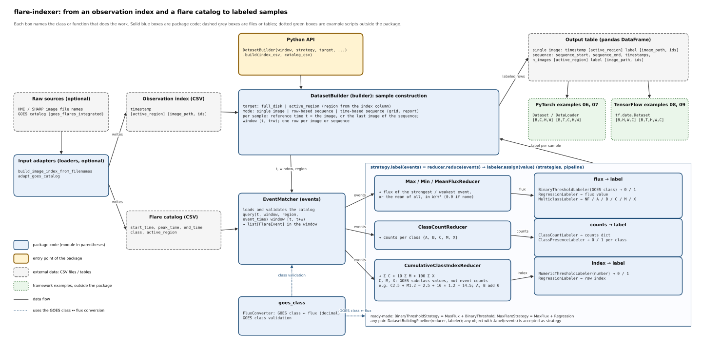

# flare-indexer

flare-indexer builds labeled datasets for solar flare prediction. You give it
the times of your solar images and a GOES flare catalog. For each image, or
each sequence of images, it finds the flares in the prediction window after
the image and turns them into a label: binary, flux, class, counts, a
cumulative index or the relative X-ray flux. Full-disk and active-region
data are both supported.



## Installation

Python 3.10 or newer. The only dependencies are pandas and numpy.

```bash
git clone https://github.com/assemkdv/flare-indexer.git
cd flare-indexer
pip install .
```

## Quick start

```python
import flare_indexer as fidx

builder = fidx.FullDiskSingleImage(
    prediction_window="24h",                     # window [t, t + 24h)
    strategy=fidx.BinaryThresholdStrategy("M"),  # 1 if a flare >= M1.0 starts in it
)
labels = builder.build("examples/data/full_disk_image_index.csv",
                       "examples/data/flare_catalog.csv")
```

The result is a pandas DataFrame with one row per image and a `label`
column. A flare counts if it starts at the image time `t` or later, and
before `t + 24h`.

The image index is a CSV with a `timestamp` column (plus `active_region`
for active-region labels). The flare catalog is a CSV with
`start_time, peak_time, end_time, class, active_region`.

## Four kinds of dataset

| Class | Each row is labeled from |
|---|---|
| `FullDiskSingleImage` | one full-disk image |
| `FullDiskSequence` | a sequence of full-disk images |
| `ActiveRegionSingleImage` | one active-region patch (only that region's flares count) |
| `ActiveRegionSequence` | a sequence of patches of one region |

All four are used the same way. The sequence classes also take `cadence`,
`observation_window` and `sliding_window`.

## Labels

Binary (≥ a GOES class), peak flux (strongest, weakest, mean), GOES class,
flare counts per class, the cumulative index ΣC + 10ΣM + 100ΣX, and the
relative X-ray flux increase (RXF), or your own.

## Documentation

- [docs/DATASETS.md](docs/DATASETS.md): inputs, the prediction window, the
  four classes and all their settings, preparing real data
- [docs/LABELS.md](docs/LABELS.md): every label with an example, building
  your own, and RXF

## Examples

| Script | Shows |
|---|---|
| `examples/01_full_disk.py` | single-image labels |
| `examples/02_sequences.py` | image sequences |
| `examples/03_active_region.py` | active-region labels |
| `examples/04_loaders.py` | preparing real inputs |
| `examples/05_flare_indices.py` | GC max, GC sum, RXF max, RXF sum |
| `examples/06_pytorch_images.py`, `07_pytorch_sequences.py` | real HMI images in PyTorch |
| `examples/08_tensorflow_images.py`, `09_tensorflow_sequences.py` | real HMI images in TensorFlow |

Examples 01–05 use the synthetic data in `examples/data/`. Examples 06–09
need `pip install ".[pytorch-examples]"` or `".[tensorflow-examples]"` and
download about 10 MB of images; see
[examples/real_data/README.md](examples/real_data/README.md).

## Tests

```bash
pip install -e ".[dev]"
pytest
```

## License

GPL-3.0-or-later. See [LICENSE](LICENSE).
