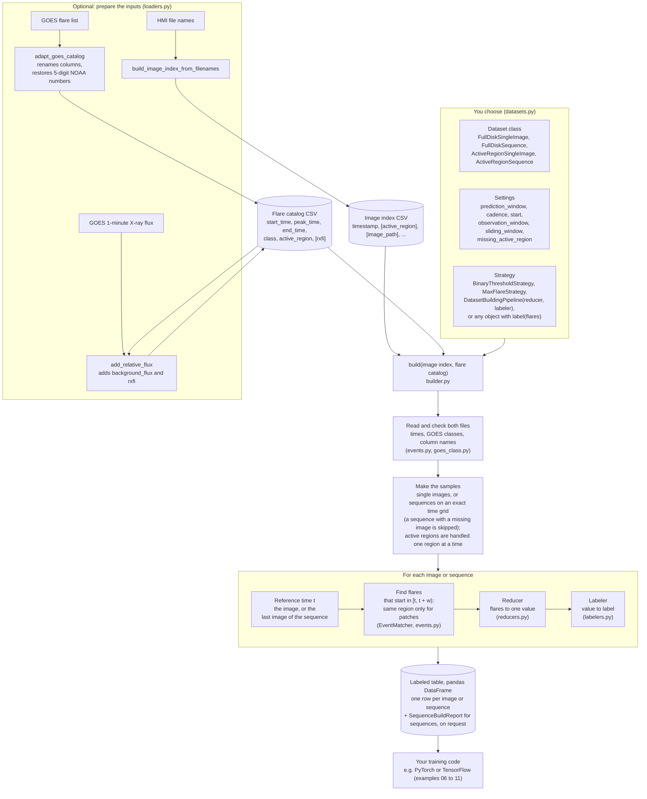

# flare-indexer

flare-indexer builds labeled datasets for solar flare prediction. You give it
the times of your solar images and a GOES flare catalog. For each image, or
each sequence of images, it finds the flares in the prediction window after
the image and turns them into a label: binary, flux, class, counts, a
cumulative index or the relative X-ray flux. Full-disk and active-region
data are both supported.

## How it works



Reducers: MaxFlux, MinFlux, MeanFlux, ClassCount, CumulativeClassIndex,
MaxRelativeFlux, SumRelativeFlux. Labelers: BinaryThreshold,
NumericThreshold, Regression, Multiclass, ClassCount, ClassPresence.
`BinaryThresholdStrategy` is MaxFlux + BinaryThreshold, and
`MaxFlareStrategy` is MaxFlux + Regression.

## Repository structure

```text
flare-indexer/
├── src/flare_indexer/          the package
│   ├── __init__.py             the public names (import flare_indexer as fidx)
│   ├── datasets.py             the four dataset classes you choose from
│   ├── builder.py              DatasetBuilder: reads the inputs, makes the samples, collects the labels
│   ├── events.py               loads and checks the flare catalog; finds the flares in a window
│   ├── goes_class.py           GOES class text to flux and back (C10.0 == M1.0)
│   ├── reducers.py             flares to one value
│   ├── labelers.py             value to label
│   ├── strategies.py           two ready-made reducer + labeler pairs
│   ├── pipeline.py             DatasetBuildingPipeline: any reducer + labeler
│   └── loaders.py              optional helpers that prepare the two input files
├── examples/                   01 to 05 synthetic data, 06 to 11 real data with PyTorch and TensorFlow
│   ├── data/                   the synthetic image indexes and flare catalog
│   └── real_data/              download scripts, image readers, manifests and the real flare catalog
├── tests/                      the automated tests, one file per topic
├── docs/                       DATASETS.md, LABELS.md and the architecture figure
├── .github/workflows/test.yml  runs the tests on Python 3.10 to 3.13 for every push
├── setup.cfg, setup.py         package metadata and dependencies
└── LICENSE                     GPL-3.0-or-later
```

## Installation

Python 3.10 or newer. The only dependencies are pandas (2.0 or newer) and numpy.

```bash
git clone https://github.com/assemkdv/flare-indexer.git
cd flare-indexer
pip install .
```

## Quick start

```python
import flare_indexer as fidx

builder = fidx.FullDiskSingleImage(
    prediction_window="24h",                     # window [t, t + 24h)
    strategy=fidx.BinaryThresholdStrategy("M"),  # 1 if a flare >= M1.0 starts in it
)
labels = builder.build("examples/data/full_disk_image_index.csv",
                       "examples/data/flare_catalog.csv")
```

The result is a pandas DataFrame with one row per image and a `label`
column. A flare counts if it starts at the image time `t` or later, and
before `t + 24h`.

The image index is a CSV with a `timestamp` column (plus `active_region`
for active-region labels). The flare catalog is a CSV with
`start_time, peak_time, end_time, class, active_region`.

## Four kinds of dataset

| Class | Each row is labeled from |
|---|---|
| `FullDiskSingleImage` | one full-disk image |
| `FullDiskSequence` | a sequence of full-disk images |
| `ActiveRegionSingleImage` | one active-region patch (only that region's flares count) |
| `ActiveRegionSequence` | a sequence of patches of one region |

All four are used the same way. The sequence classes also take `cadence`,
`observation_window` and `sliding_window`.

## Labels

Binary (≥ a GOES class), peak flux (strongest, weakest, mean), GOES class,
flare counts per class, the cumulative index ΣC + 10ΣM + 100ΣX, and the
relative X-ray flux increase (RXF), or your own.

## Documentation

- [docs/DATASETS.md](docs/DATASETS.md): inputs, the prediction window, the
  four classes and all their settings, preparing real data
- [docs/LABELS.md](docs/LABELS.md): every label with an example, building
  your own, and RXF

## Examples

| Script | Shows |
|---|---|
| `examples/01_full_disk.py` | single-image labels |
| `examples/02_sequences.py` | image sequences |
| `examples/03_active_region.py` | active-region labels |
| `examples/04_loaders.py` | preparing real inputs |
| `examples/05_flare_indices.py` | GC max, GC sum, RXF max, RXF sum |
| `examples/06_pytorch_images.py`, `07_pytorch_sequences.py` | real HMI images in PyTorch |
| `examples/08_tensorflow_images.py`, `09_tensorflow_sequences.py` | real HMI images in TensorFlow |
| `examples/10_pytorch_active_region.py`, `11_tensorflow_active_region.py` | real active-region patches in PyTorch and TensorFlow |

Examples 01–05 use the synthetic data in `examples/data/`. Examples 06–11
need `pip install ".[pytorch-examples]"` or `".[tensorflow-examples]"`.
06–09 need about 10 MB of full-disk images, downloaded once by
`examples/real_data/fetch_real_data.py`; the active-region patches of
10–11 are in the repository. See
[examples/real_data/README.md](examples/real_data/README.md).

## Tests

```bash
pip install -e ".[dev]"
pytest
```

## License

GPL-3.0-or-later. See [LICENSE](LICENSE).
