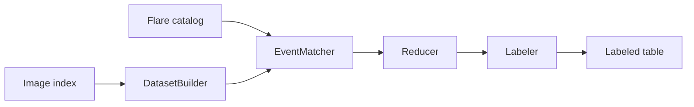
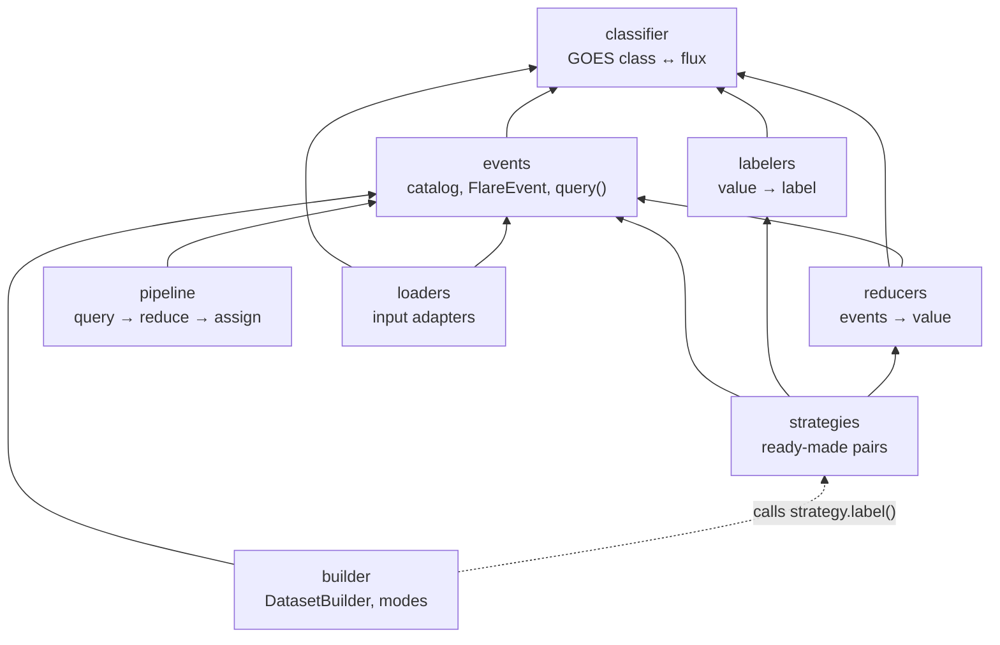

# System design

This document follows the labeling process. See the
[researcher manual](../researcher_manual.md) for full configuration details
and the [API reference](../api_reference.md) for every public name.

## Inputs and output

- **Image index:** a CSV containing `timestamp`, optionally `image_path` and
  other metadata. Active-region mode also requires an `active_region` column.
- **Flare catalog:** full start/peak/end timestamps, class, and region.
  Loaders adapt supported external formats.
- **Output:** a pandas DataFrame with one row per image or sequence and a
  `label` column. Metadata can be preserved with `include_metadata=True`.

The core package uses timestamps and catalog events. It does not read pixels,
download data, or train models.

## Processing



1. The builder validates inputs and creates image or sequence examples.
2. The matcher selects events inside the prediction window. In active-region
   mode, it also filters by the example's region.
3. The reducer selects maximum/minimum flux, counts all events by class,
   or sums weighted class numbers (cumulative class index).
4. The labeler returns the requested answer. The builder collects the rows.

`BinaryThresholdStrategy` and `MaxFlareStrategy` provide ready-made combinations.
`DatasetBuildingPipeline` connects other reducers and labelers. Its `run_one()`
returns events, reduced value, and label for inspection.

## Module dependencies

The package is eight modules in `src/flare_indexer/`, arranged in layers.
An arrow means "imports from"; a module only imports from layers below it,
so there are no cycles. `tests/test_module_dependencies.py` checks this
table against the actual import statements.



| Layer | Modules | Knows about |
|---|---|---|
| 0 | `classifier` | only the GOES scale: `to_flux` (text → W/m²), `to_class` (W/m² → letter), `is_strong` |
| 1 | `events`, `labelers` | `classifier` |
| 2 | `reducers` | `classifier`, `events` |
| 3 | `strategies`, `pipeline`, `builder` | the layers below; `pipeline` and `builder` import only `events` (reducers, labelers and strategies reach them as objects) |
| side | `loaders` | `classifier`, `events`; converts lab files into the two input CSVs |

Two consequences of this shape:

- Everything about GOES classes (the boundaries, decimal conversion,
  `C10.0 == M1.0`) is in `classifier`. `MulticlassLabeler` and
  `ClassCountReducer` call `FluxConverter.to_class` instead of repeating
  the rule.
- `builder` does not import `strategies`, `pipeline` or `reducers`. It
  receives `strategy=` as an object and calls `.label(flares)` on it, so
  any object with that method works (the dotted arrow). This is what lets
  a user plug in a custom reducer/labeler pair without changing the
  builder.

## Labeling choices

- **Binary:** maximum flux + binary threshold; M means M1.0 or stronger.
- **Maximum flux:** maximum flux + regression labeler.
- **Minimum flux:** minimum event peak flux + regression labeler.
- **Multiclass:** maximum flux + NF/A/B/C/M/X labeler.
- **Counts:** all-event class counts + count labeler.
- **Presence:** all-event class counts + presence labeler (0/1 per class).
- **Cumulative class index:** Σ C + 10 Σ M + 100 Σ X of the class numbers
  (Hong, Ji, Pandey, Aydin, DaWaK 2023; SuryaBench) + regression labeler
  for the raw index, or numeric threshold labeler (10 in SuryaBench, 20 in
  the paper) for a binary label. A and B add 0 (selected convention,
  pending confirmation).

Flux is compared numerically, not by sorting class text. C10.0 and M1.0
convert to the same strength. Counts do not remove duplicate records.
Empty windows give zero flux, zero counts/presence, a zero index, or NF
for multiclass. Index thresholds are plain numbers; GOES-class thresholds
are converted to flux. The two labelers are separate on purpose.

## Time and sequences

The reference time is the image timestamp or the sequence's last timestamp.
Current defaults match **peak time** in `[t, t+w)`: include the reference time
and exclude the window end. Start-time matching and `(t, t+w]` are configurable.
The legacy full-disk comparison uses start time and `(t, t+23h59m59s]`.
These settings are distinct; they are not interchangeable for subsecond data.

- **Frame-count sequences:** select `sequence_length` rows, then advance by
  `stride`. Optional `cadence_minutes` checks spacing.
- **Duration-based sequences:** use cadence, observation window, and sliding
  window to construct exact grids. Missing frames cause a candidate to be skipped.
- **Active-region sequences:** group images by region first. Each sequence
  contains only one region; duplicate times within a group are invalid.

`return_report=True` provides a `SequenceBuildReport` in time-based mode.
It records candidate, emitted, and skipped counts and samples of missing times.

## Input checks and missing data

Catalog loading validates GOES classes and available `start <= peak <= end`
times. Equal times are allowed; a missing time is skipped; out-of-order
records are rejected, not shifted. Every time carries its own date, so
midnight-crossing events are represented as written. An event missing the
selected start or peak cannot be matched by that basis.

For images without a region, `missing_active_region` chooses a negative/empty
result with a warning, exclusion, or an error. Catalog events without a region
cannot match a named region. The package does not guess a location or use
full-disk matching as a substitute.

## Research validation and framework examples

Both research validation scripts use `scripts/catalog_corrections.py` to create
a corrected copy of the specific lab catalog: six midnight peaks move to the
next day and one unknown peak becomes missing. Each correction is checked
against the original record and reported. The source file remains unchanged.

Start-time results remain unchanged: 63,649/63,649 full-disk labels agree under
the legacy window; AR look-back reproduces 511,421/511,421 published rows.
The package's forward AR labels agree on 499,009 rows. The cumulative class
index reproduces all 128,328 published SuryaBench `label_cum` values when
run on SuryaBench's catalog, and all 75,638 within the lab catalog's
recorded-event bounds when run on the lab catalog. Details and evidence:
[full disk](../validation/full_disk.md), [active regions](../validation/active_region.md),
[cumulative index](../validation/cumulative_index.md).

The PyTorch and TensorFlow examples load real HMI pixels and pair them with
labels. Their download helper replays recorded image IDs/URLs and checks hashes.
The core package has no dependency on either framework.

## One inspectable example

This uses invented events directly to show the reducer/labeler stage. Catalog
matching and image loading are not part of this small example.

<!-- example: architecture_choices -->
```python
from flare_indexer import (
    FlareEvent, DatasetBuildingPipeline, MaxFluxReducer, MinFluxReducer,
    ClassCountReducer, BinaryThresholdLabeler, RegressionLabeler,
    MulticlassLabeler, ClassCountLabeler, ClassPresenceLabeler,
)

# Only strength matters to these reducers; times are unused here.
events = [
    FlareEvent(peak_time=None, goes_class=value, start_time=None, active_region=None)
    for value in ("C2.0", "C2.0", "M2.0")
]
choices = [
    ("binary", MaxFluxReducer(), BinaryThresholdLabeler("M")),
    ("maximum", MaxFluxReducer(), RegressionLabeler()),
    ("minimum", MinFluxReducer(), RegressionLabeler()),
    ("multiclass", MaxFluxReducer(), MulticlassLabeler()),
    ("counts", ClassCountReducer(), ClassCountLabeler()),
    ("presence", ClassCountReducer(), ClassPresenceLabeler()),
]
for name, reducer, labeler in choices:
    print(name, DatasetBuildingPipeline(reducer, labeler).label(events))
```
<!-- output: architecture_choices -->
```text
binary 1
maximum 2e-05
minimum 2e-06
multiclass M
counts {'A': 0, 'B': 0, 'C': 2, 'M': 1, 'X': 0}
presence {'A': 0, 'B': 0, 'C': 1, 'M': 1, 'X': 0}
```

## Remaining limits

The cumulative class index follows the reference formula; whether A/B
flares should contribute, and whether the window should be the paper's
closed `[t, t+24h]` (not expressible with the two `interval_mode`
options, which are `[t, t+w)` and `(t, t+w]`) or the reference code's
`(t, t+23:59:59]`, await confirmation. The relative-flux indices (rxfi) of
the same paper need a per-flare background flux the catalogs do not carry
and are not implemented. Core windows only look forward.
There is no TAI/UTC conversion, catalog-coverage check, or sequence timestamp
tolerance. Multiclass and counts reject positive flux below A1.0. These choices
and limitations are recorded in [decision notes](../decisions.md).
