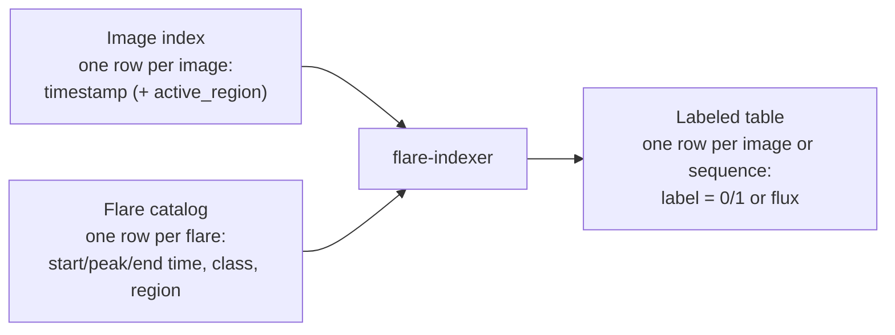
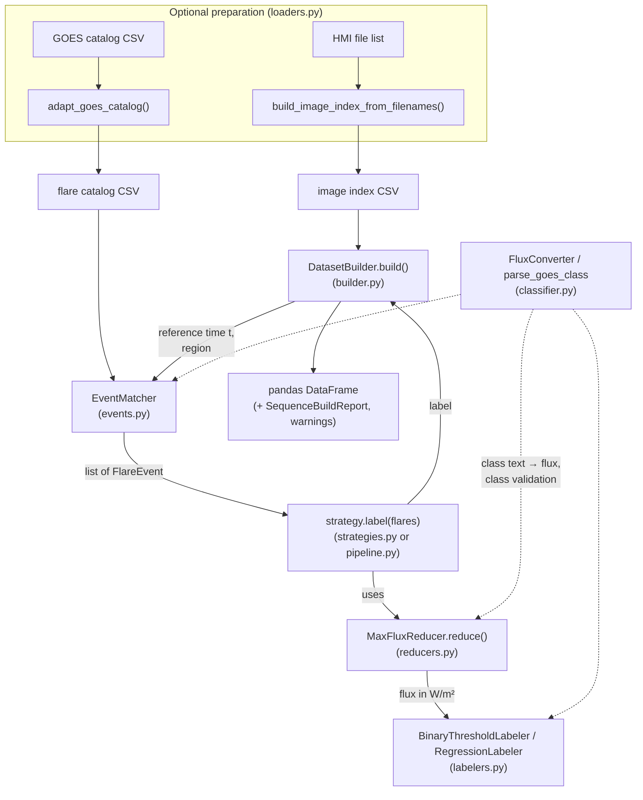
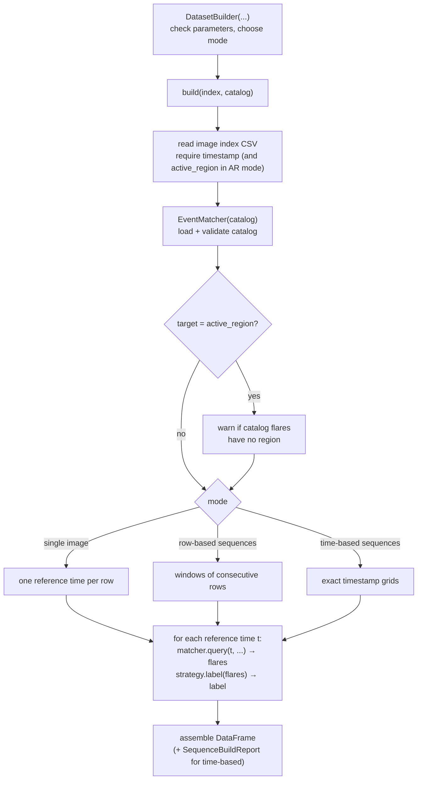
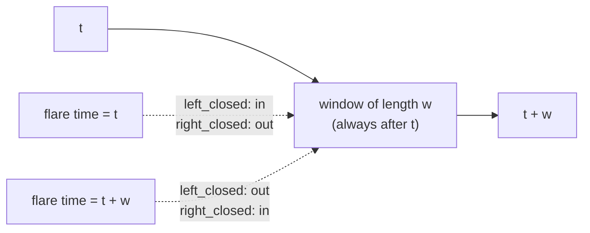
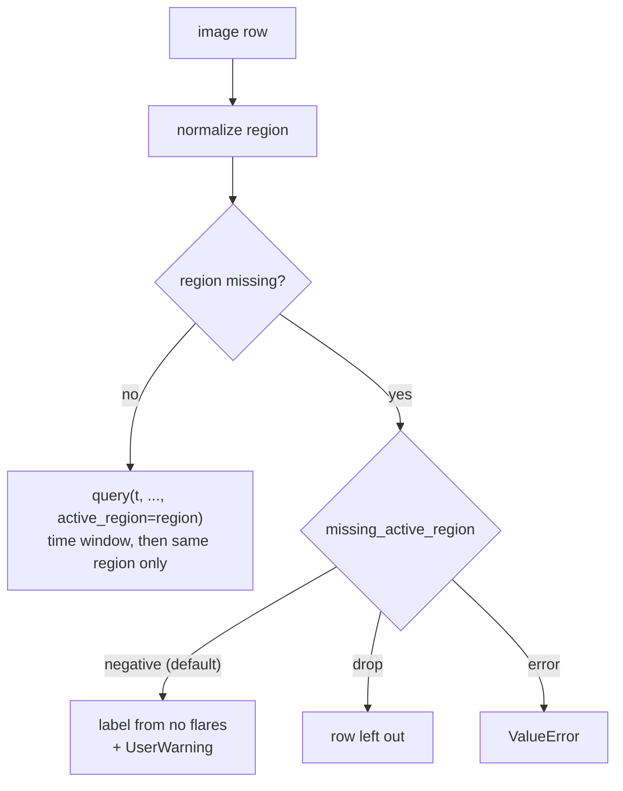
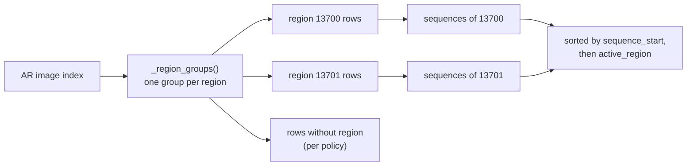

# System design

This document explains how flare-indexer works inside, using the real
file, class and function names in `src/flare_indexer/`. It is written for
someone new to the code. For how to *use* the package, see the
[researcher manual](../researcher_manual.md); for every signature, see the
[API reference](../api_reference.md).

Code blocks marked "Run" were executed from the repository root against
`docs/fixtures/`, and their output is the real output (checked by
`scripts/check_doc_examples.py`).

## Contents

1. [The problem in one picture](#1-the-problem-in-one-picture)
2. [Overall architecture](#2-overall-architecture)
3. [Modules one by one](#3-modules-one-by-one)
4. [How DatasetBuilder connects the components](#4-how-datasetbuilder-connects-the-components)
5. [Time matching](#5-time-matching)
6. [Region matching](#6-region-matching)
7. [Single-image and sequence workflows](#7-single-image-and-sequence-workflows)
8. [Strategies, reducers and labelers](#8-strategies-reducers-and-labelers)
9. [Validation, warnings and errors](#9-validation-warnings-and-errors)
10. [What is configurable and what is fixed](#10-what-is-configurable-and-what-is-fixed)
11. [Custom components](#11-custom-components)
12. [Trace: one small dataset through the system](#12-trace-one-small-dataset-through-the-system)
13. [Trace: stopping early without a dataset](#13-trace-stopping-early-without-a-dataset)
14. [Diagrams: tools and how to edit them](#14-diagrams-tools-and-how-to-edit-them)

---

## 1. The problem in one picture



Two tables go in; one table comes out. For each image (or sequence), the
package asks: which flares fall in the time window after this image (and,
optionally, belong to the same region)? It then turns those flares into
one label.

## 2. Overall architecture



How to read it: solid arrows carry data from one component to the next;
dotted arrows mean "uses as a helper". The preparation box is optional:
if your files already have the right columns, you skip it. Every label is
produced by the same three steps: **match** (EventMatcher), **reduce**
(reducer), **assign** (labeler). `DatasetBuilder` only repeats these steps
for every image and assembles the results.

The same picture, with more detail, is page 1 of
[`flare_indexer_architecture.pdf`](flare_indexer_architecture.pdf).

## 3. Modules one by one

Each row says what enters the module, what happens there, what leaves,
and who receives it.

| Module | Why it exists | Contents | Input | Processing | Output → receiver |
|---|---|---|---|---|---|
| `classifier.py` | One place that understands GOES class text | `FluxConverter`, `FlareClassifier`, `InvalidGOESClassError`, `parse_goes_class`, `validate_goes_class_column` | class text, e.g. `"M2.3"` | checks the format; letter → base flux × number | flux `float` → reducers, labelers; errors → caller |
| `events.py` | Load the catalog once and answer "which flares are in this window?" fast | `FlareEvent`, `EventMatcher` | catalog CSV path; per query: `t`, window, region, `event_time`, `interval_mode` | detects schema, parses times, validates classes, keeps a sorted copy per `event_time`, binary search for the window, optional region filter | `list[FlareEvent]` → strategy or pipeline |
| `reducers.py` | Turn many flares into one number | `EventReducer` (contract), `MaxFluxReducer` | `list[FlareEvent]` | max of `FluxConverter.to_flux(class)`; `0.0` if empty | `float` → labeler |
| `labelers.py` | Turn that number into the final label | `LabelAssigner` (contract), `BinaryThresholdLabeler`, `RegressionLabeler`, `MulticlassLabeler` | reduced value | compare with threshold flux, pass through as a plain number, or map to a GOES class letter by flux boundaries | label → strategy / pipeline |
| `strategies.py` | Ready-made reducer + labeler pairs | `BinaryThresholdStrategy`, `MaxFlareStrategy` | `list[FlareEvent]` | `MaxFluxReducer` then a labeler | label → `DatasetBuilder` |
| `pipeline.py` | Run and inspect the three steps separately | `DatasetBuildingPipeline`, `PipelineResult` | matcher, `t`, window; or events; or a value | calls `query`, then `reducer.reduce`, then `labeler.assign` | events / value / label / `PipelineResult` → researcher, or label → `DatasetBuilder` |
| `builder.py` | Label a whole image index | `DatasetBuilder`, `SequenceBuildReport` | image index CSV, catalog CSV, settings | validates settings and index; picks the mode; loops over reference times; groups by region for AR sequences | `DataFrame` (+ report) → researcher |
| `loaders.py` | Convert lab file formats | `build_image_index_from_filenames`, `adapt_goes_catalog`, `ImageIndexReport` | HMI path list; GOES catalog CSV | parse file names; rename/normalize columns; validate classes | `DataFrame` (+ report, optional CSV) → `DatasetBuilder` |
| `__init__.py` | Public entry point | re-exports 19 names | – | – | `import flare_indexer as fidx` |

Supporting scripts outside the package: `scripts/validate_full_disk.py`
and `scripts/validate_active_region.py` compare package output with the
lab's published labels; `scripts/check_doc_examples.py` runs the
documentation examples.

## 4. How DatasetBuilder connects the components



Step by step:

1. **Constructor** (`DatasetBuilder.__init__`): checks every parameter
   (window > 0, valid `target`, `event_time`, `interval_mode`,
   `missing_active_region`; row-based and time-based parameters not
   mixed; time-based durations are whole multiples of `cadence`). Nothing
   is read from disk yet.
2. **`build()`** reads the image index with `pandas.read_csv`, converts
   `timestamp` to date-times, and checks required columns.
3. It creates one `EventMatcher` for the catalog. Loading happens once
   per `build()` call.
4. It dispatches to one of six private builders (three modes × two
   targets). Each private builder produces reference times, calls
   `matcher.query`, then `strategy.label`, and collects one record per
   image or sequence.
5. It returns a `DataFrame` (and a `SequenceBuildReport` in time-based
   mode when `return_report=True`).

The builder never inspects flares itself; matching belongs to
`EventMatcher` and labeling to the strategy. That is why any object with a
`label(flares)` method can be a strategy.

**Bypassing the builder:** a researcher can create an `EventMatcher` and
call `query`, a reducer and a labeler directly, or use
`DatasetBuildingPipeline` (see §13). The builder adds only the loop,
sequence construction, region grouping and the output table.

## 5. Time matching

Inside `EventMatcher.query(t, window, active_region, event_time,
interval_mode)` (`events.py`):

1. `window_end = t + window`. A number is hours; text such as
   `"23h59min59s"` is a duration. The window always lies **after** `t`.
2. Pick the time column: `peak_time` (`event_time="peak"`) or
   `start_time` (`"start"`).
3. Use a cached, sorted copy of that column and `numpy.searchsorted` to
   find the first and last flare inside the window:

| `interval_mode` | Window | Flare exactly at `t` | Flare exactly at `t + w` |
|---|---|---|---|
| `left_closed` (default) | `[t, t+w)` | counted | not counted |
| `right_closed` | `(t, t+w]` | not counted | counted |

4. Optionally keep only flares of the requested region (§6).
5. Return a list of `FlareEvent` objects.



Times are compared exactly as stored; there is no time-zone or TAI/UTC
conversion.

## 6. Region matching

With `target="active_region"`:

- Region values on both sides are normalized by `_normalize_active_region`
  (`events.py`): `13700`, `13700.0` and `"13700"` all become `"13700"`;
  blank becomes "missing".
- `EventMatcher.query(..., active_region="13700")` first finds the flares
  in the time window, then keeps only those whose region equals
  `"13700"`. Flares with a missing region never match.
- An image with a missing region is never queried (it would otherwise
  match nothing or, worse, everything). `missing_active_region` decides
  whether it is labeled as if no flare occurred (with a warning), dropped,
  or rejected.
- The package never falls back to full-disk matching.



## 7. Single-image and sequence workflows

| | Single image | Row-based sequences | Time-based sequences |
|---|---|---|---|
| Activated by | default (`sequence_length` 1) | `sequence_length > 1` | `cadence`, `observation_window`, `sliding_window` (+ optional `start`) |
| Reference time `t` | image time | last image of the window | last image of the grid |
| Index requirements | none on order or duplicates | sorted, unique | unique |
| Gaps | not relevant | skipped only if `cadence_minutes` is set | grid with any missing time is skipped and reported |
| Private builder | `_build_single_image[_active_region]` | `_build_sequences[_active_region]` | `_build_time_based_sequences[_active_region]` |

**Active-region sequences** (`_region_groups` in `builder.py`): rows are
first grouped by normalized region. The checks above apply inside each
region, so several regions can share timestamps. Rows without a region
never join a region's sequence. For time-based mode the source cadence is
inferred from all image times, and each region gets its own grid.



## 8. Strategies, reducers and labelers

A **strategy** is whatever `DatasetBuilder` calls: `label(flares)`.
Internally both built-in strategies are a reducer followed by a labeler:

| Strategy | Reducer | Labeler | Label |
|---|---|---|---|
| `BinaryThresholdStrategy("M")` | `MaxFluxReducer` → max flux (float, W/m²) | `BinaryThresholdLabeler("M")` → `int(flux >= 1e-5)` | `0` or `1` |
| `MaxFlareStrategy()` | `MaxFluxReducer` | `RegressionLabeler` → the flux unchanged | float W/m² |

`DatasetBuildingPipeline(reducer, labeler)` is the same composition, but
it also exposes each step and has a `label(events)` method, so it can be
passed as `strategy=` too. Class text (`"M2.0"`) is converted to a flux
number (`2e-05`) before any comparison; text is never compared
alphabetically.

## 9. Validation, warnings and errors

| When | Check | Result if it fails |
|---|---|---|
| `DatasetBuilder(...)` | window positive and finite; valid option values; sequence parameters consistent | `ValueError` |
| `EventMatcher(...)` (also inside `build`) | non-empty file; one of two schemas; parsable times; valid GOES classes | `ValueError` / `InvalidGOESClassError` naming file, column and lines |
| `build()` | `timestamp` (and `active_region`) columns present; sequence order/uniqueness; cadence compatibility; no output-column name clashes | `ValueError` |
| `build()`, AR mode | catalog flares without region | `UserWarning` (labels still produced) |
| `build()`, AR mode | images without region | per `missing_active_region`: `UserWarning`, drop, or `ValueError` |
| `DatasetBuildingPipeline(...)` | reducer has `reduce`, labeler has `assign` | `TypeError` |
| loaders | file-name pattern, duplicates, required columns, classes | `ValueError` (or exclusion + report with `strict=False`) |

Warnings never change a label; they report that a label rests on an
assumption.

## 10. What is configurable and what is fixed

**Configurable** (constructor arguments): window length; `event_time`;
`interval_mode`; target (full disk / active region); strategy (any object
with `label`); threshold class; sequence mode and its parameters;
missing-region policy; metadata in the output. Loaders: `strict`,
`duplicate_policy`.

**Fixed in the code:**

- windows always start at `t` and look forward;
- GOES letter-to-flux scale (A 1e-8 … X 1e-4);
- region equality after normalization is the only region rule (no
  location-based assignment);
- the reference time of a sequence is its last image;
- time-based grids are never interpolated;
- no time-zone or coverage handling.

## 11. Custom components

| You write | Must provide | Plug into |
|---|---|---|
| reducer | `reduce(events) -> value` | `DatasetBuildingPipeline(reducer=..., ...)` |
| labeler | `assign(value) -> label` | `DatasetBuildingPipeline(..., labeler=...)` |
| strategy | `label(flares) -> label` | `DatasetBuilder(strategy=...)` |

No inheritance is required ("duck typing"): the pipeline checks only that
the method exists. `EventReducer` and `LabelAssigner` in `reducers.py`
and `labelers.py` are `typing.Protocol` classes; they document the
expected method and are not meant to be instantiated. Worked examples are
in the [researcher manual §13](../researcher_manual.md#13-custom-reducers-labelers-and-strategies).

## 12. Trace: one small dataset through the system

This trace repeats, step by step and with public functions, what
`DatasetBuilder` does for the single-image, full-disk case
(`_build_single_image` in `builder.py`), and then checks that the result
equals `DatasetBuilder.build()`.

**Inputs.** Run:

<!-- example: trace_inputs -->
```python
from pathlib import Path

print(Path("docs/fixtures/images.csv").read_text())
print(Path("docs/fixtures/catalog.csv").read_text())
```
<!-- output: trace_inputs -->
```text
timestamp,image_path
2024-05-01 00:00:00,hmi/HMI.m2024.05.01_00.00.00.jpg
2024-05-01 03:00:00,hmi/HMI.m2024.05.01_03.00.00.jpg
2024-05-01 06:00:00,hmi/HMI.m2024.05.01_06.00.00.jpg
2024-05-01 09:00:00,hmi/HMI.m2024.05.01_09.00.00.jpg
2024-05-01 18:00:00,hmi/HMI.m2024.05.01_18.00.00.jpg

start_time,peak_time,end_time,class,active_region
2024-05-01 02:00:00,2024-05-01 02:15:00,2024-05-01 02:30:00,C4.0,13700
2024-05-01 05:30:00,2024-05-01 05:45:00,2024-05-01 06:00:00,M2.0,13700
2024-05-01 08:00:00,2024-05-01 08:10:00,2024-05-01 08:20:00,X1.2,13701
2024-05-02 00:00:00,2024-05-02 00:20:00,2024-05-02 00:40:00,M1.0,

```

**Settings:** window 6 hours, `event_time="start"`,
`interval_mode="right_closed"` (window `(t, t+6h]`), threshold `"M"`.

**Step 1 – loading.** `build()` reads the index and converts timestamps;
`EventMatcher` loads and validates the catalog (requires `Path` from the
previous block):

<!-- example: trace_loading -->
```python
import pandas as pd
import flare_indexer as fidx

index_df = pd.read_csv("docs/fixtures/images.csv")
index_df["timestamp"] = pd.to_datetime(index_df["timestamp"])
matcher = fidx.EventMatcher("docs/fixtures/catalog.csv")
print("reference times:", [str(t) for t in index_df["timestamp"]])
```
<!-- output: trace_loading -->
```text
reference times: ['2024-05-01 00:00:00', '2024-05-01 03:00:00', '2024-05-01 06:00:00', '2024-05-01 09:00:00', '2024-05-01 18:00:00']
```

**Steps 2–4 – match, reduce, assign** for every reference time (requires
`index_df`, `matcher`):

<!-- example: trace_loop -->
```python
reducer = fidx.MaxFluxReducer()
labeler = fidx.BinaryThresholdLabeler("M")
records = []
for t in index_df["timestamp"]:
    events = matcher.query(t, 6, event_time="start", interval_mode="right_closed")   # step 2
    value = reducer.reduce(events)                                                     # step 3
    label = labeler.assign(value)                                                      # step 4
    print(f"t={t:%H:%M}  events={[e.goes_class for e in events]!s:18} max flux={value:<8} label={label}")
    records.append({"timestamp": t, "label": label})
```
<!-- output: trace_loop -->
```text
t=00:00  events=['C4.0', 'M2.0']   max flux=2e-05    label=1
t=03:00  events=['M2.0', 'X1.2']   max flux=0.00012  label=1
t=06:00  events=['X1.2']           max flux=0.00012  label=1
t=09:00  events=[]                 max flux=0.0      label=0
t=18:00  events=['M1.0']           max flux=1e-05    label=1
```

What happens at each transition, for `t = 03:00`:

- **match:** window `(03:00, 09:00]` on `start_time`. M2.0 starts 05:30
  and X1.2 starts 08:00, so `query` returns two `FlareEvent`s. C4.0
  (02:00) is before the window; M1.0 (next day) is after it.
- **reduce:** class text becomes flux: M2.0 → 2.0e-5, X1.2 → 1.2e-4. The
  maximum is `0.00012` (a float in W/m², not text).
- **assign:** `0.00012 >= 1e-5` (M1.0), so the label is `1`.

For `t = 09:00` the window `(09:00, 15:00]` is empty, the reducer returns
`0.0`, and the label is `0`. For `t = 18:00`, M1.0 starts at exactly
`t + 6h`, which the right-closed window includes; `1e-05 >= 1e-5`, so `1`.

**Step 5 – output.** The records become the output table, which is
identical to what `DatasetBuilder` produces (requires `records`):

<!-- example: trace_output -->
```python
traced = pd.DataFrame(records)
built = fidx.DatasetBuilder(
    prediction_window=6, strategy=fidx.BinaryThresholdStrategy("M"),
    event_time="start", interval_mode="right_closed",
).build("docs/fixtures/images.csv", "docs/fixtures/catalog.csv")
print(traced.to_string(index=False))
print("identical to DatasetBuilder.build():", traced.equals(built))
```
<!-- output: trace_output -->
```text
          timestamp  label
2024-05-01 00:00:00      1
2024-05-01 03:00:00      1
2024-05-01 06:00:00      1
2024-05-01 09:00:00      0
2024-05-01 18:00:00      1
identical to DatasetBuilder.build(): True
```

## 13. Trace: stopping early without a dataset

A researcher who only wants to inspect one time point does not need
`DatasetBuilder`. `DatasetBuildingPipeline` exposes each step; each call
returns a different kind of result (requires `fidx`, `matcher`, `pd`
from §12):

<!-- example: trace_stop -->
```python
pipeline = fidx.DatasetBuildingPipeline(fidx.MaxFluxReducer(), fidx.BinaryThresholdLabeler("M"))
t = pd.Timestamp("2024-05-01 00:00")

events = pipeline.extract_events(matcher, t, 6, event_time="start", interval_mode="right_closed")
print("after matching :", type(events).__name__, [(e.goes_class, str(e.start_time)) for e in events])

value = pipeline.reduce_events(events)
print("after reducing :", type(value).__name__, value)

label = pipeline.assign_label(value)
print("after assigning:", type(label).__name__, label)

region_only = pipeline.extract_events(matcher, t, 6, active_region="13701",
                                      event_time="start", interval_mode="right_closed")
print("region 13701 only:", region_only)
```
<!-- output: trace_stop -->
```text
after matching : list [('C4.0', '2024-05-01 02:00:00'), ('M2.0', '2024-05-01 05:30:00')]
after reducing : float 2e-05
after assigning: int 1
region 13701 only: []
```

Stopping after matching gives a `list` of `FlareEvent` objects; after
reducing, a `float` flux; after assigning, an `int` label. Region 13701's
only flare (X1.2 at 08:00) is outside `(00:00, 06:00]`, so the
region-filtered list is empty.

## 14. Diagrams: tools and how to edit them

This document's diagrams are **Mermaid** code blocks. GitHub draws them
automatically when you view the file; to change one, edit the text inside
the ```` ```mermaid ```` block. Each box is a node (`ID["text"]`) and each
arrow is `A --> B` (solid) or `A -.-> B` (dotted).

The six-page architecture set is maintained separately:

| File | Format | Made by |
|---|---|---|
| `docs/architecture/flare_indexer_architecture.drawio` | editable draw.io (one tab per page) | `docs/architecture/build_diagrams.py` |
| `docs/architecture/flare_indexer_architecture.pdf` | vector PDF, same six pages | the same script, using matplotlib |

Both files come from one description of boxes and arrows in
`build_diagrams.py`, so they always match. To change them, edit the
`page_*()` functions in that script and run:

```bash
pip install matplotlib
python docs/architecture/build_diagrams.py            # add --png DIR for previews
```

You can also open the `.drawio` file in [diagrams.net](https://app.diagrams.net)
(File → Open from → Device) and edit it by hand, but the next run of the
script overwrites manual edits.
